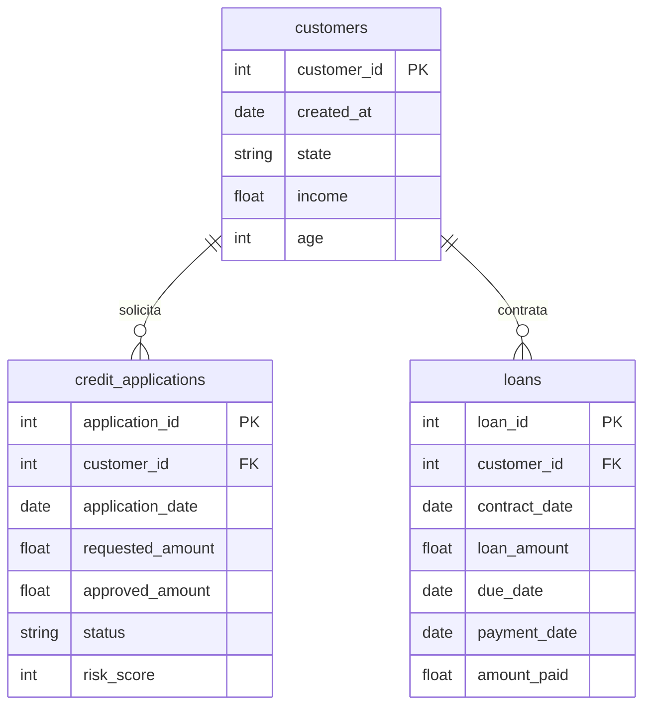

# SQL na Prática: Um Caso de Crédito

*Podcast/Workshop prático de SQL aplicado a um case de crédito*

Podcast/Workshop da disciplina 02 (SQL para cientistas de dados) da Pós-Graduação em Ciência de Dados da UNIPDS. Adaptado de um case técnico originalmente usado em entrevistas de emprego para servir como conteúdo prático do módulo.

Este podcast/workshop propõe colocar em prática, em um único caso, boa parte do que se espera de SQL analítico no dia a dia de um(a) cientista de dados: consultas básicas, construção de métricas, relacionamento entre tabelas e análises mais próximas de situações reais de negócio — dos fundamentos até window functions.

## O Case

### Contexto

Uma fintech oferece crédito para sua base de clientes. Ao longo da jornada, os clientes podem solicitar crédito, ter a proposta aprovada ou recusada e, quando aprovados, contratar um empréstimo. O time de Crédito acompanha indicadores de aprovação, concessão e inadimplência para entender a qualidade da carteira e apoiar decisões de política de crédito.

Esse cenário é um bom terreno de prática porque reúne, num caso só, boa parte dos desafios reais do SQL analítico: tabelas conectadas de forma indireta (é preciso reconstruir vínculos, não só fazer JOIN), métricas cujo numerador e denominador não são óbvios à primeira vista, e uma regra de negócio (a definição de inadimplência) que precisa ser traduzida em lógica SQL. É exatamente esse tipo de raciocínio, e não só a sintaxe, que o podcast/workshop busca exercitar.

### Estrutura da base



Repare que **não há relação direta entre `credit_applications` e `loans`**: o único vínculo entre uma solicitação aprovada e o contrato que ela eventualmente gerou é indireto, via `customer_id`. Isso tem consequência prática: quando uma pergunta do case depende de saber qual solicitação originou qual contrato (ex.: risk_score de um contrato, ou se uma aprovação específica virou empréstimo), é preciso reconstruir esse vínculo na query, uma vez não dá pra simplesmente fazer um JOIN direto pela chave.

#### customers

| Campo | Descrição |
|---|---|
| customer_id | Identificador do cliente |
| created_at | Data de cadastro |
| state | Estado |
| income | Renda mensal |
| age | Idade |

#### credit_applications

| Campo | Descrição |
|---|---|
| application_id | Identificador da solicitação |
| customer_id | Identificador do cliente |
| application_date | Data da solicitação |
| requested_amount | Valor solicitado |
| approved_amount | Valor aprovado |
| status | Status da proposta: approved ou rejected |
| risk_score | Score de risco utilizado na análise |

#### loans

| Campo | Descrição |
|---|---|
| loan_id | Identificador do contrato |
| customer_id | Identificador do cliente |
| contract_date | Data da contratação |
| loan_amount | Valor contratado |
| due_date | Data de vencimento |
| payment_date | Data do pagamento |
| amount_paid | Valor pago |

### Regras de negócio

- Uma solicitação é considerada aprovada quando status = 'approved'.
- Uma proposta aprovada não significa necessariamente que o cliente contratou o empréstimo.
- Para o case, um contrato pode ser considerado inadimplente quando o pagamento ocorre mais de 15 dias após o vencimento ou quando permanece sem pagamento após esse prazo.
- Contratos que ainda não tiveram tempo suficiente para completar a janela de 15 dias não devem ser classificados como inadimplentes.

### Questões do case

#### Parte A - Exploração e métricas básicas

1. Quantas solicitações de crédito foram realizadas por mês?
2. Qual foi o valor total solicitado e o valor total aprovado em cada mês?
3. Qual foi a taxa de aprovação das propostas?
4. Qual o ticket médio solicitado e o ticket médio aprovado?

#### Parte B - Perfil e aprovação

1. Calcule a taxa de aprovação por faixa de renda.
2. Calcule a taxa de aprovação por faixa de risk_score.
3. Qual percentual dos clientes aprovados efetivamente contratou um empréstimo?
4. Qual percentual do valor solicitado foi efetivamente aprovado?

#### Parte C - Inadimplência

1. Identifique quais contratos devem ser classificados como inadimplentes de acordo com a regra definida.
2. Calcule a taxa de inadimplência por mês de contratação.
3. Calcule a taxa de inadimplência por faixa de risk_score.
4. Qual é o valor total da carteira inadimplente?
5. Compare a inadimplência calculada por quantidade de contratos com a inadimplência calculada sobre o valor concedido.

#### Parte D - SQL avançado

1. Para cada mês, calcule a taxa de aprovação e a variação em relação ao mês anterior.
2. Para cada cliente, identifique sua primeira solicitação de crédito.
3. Identifique clientes que tiveram uma solicitação rejeitada e posteriormente uma solicitação aprovada.
4. Calcule o número de dias entre a primeira solicitação e a primeira aprovação de cada cliente.
5. Divida os clientes em cinco grupos de acordo com o risk_score e calcule a inadimplência de cada grupo.

### Questão aberta

O time de Crédito acredita que o risk_score utilizado na aprovação está conseguindo separar adequadamente clientes de maior e menor risco. Utilizando os dados disponíveis, construa uma análise em SQL que permita avaliar essa hipótese.

A intenção desta questão é deixar a definição das métricas e dos recortes a cargo de quem resolve. A análise pode considerar, por exemplo, volume de clientes, aprovação, valor concedido e inadimplência por faixas de score.

## Infraestrutura: BigQuery + DuckDB

Para resolver o case, você pode usar **BigQuery** (nuvem) ou **Python + DuckDB** (100% local). As duas alternativas são independentes, sem precisar de uma na outra. Por isso o repositório mantém **duas versões de cada query**, lado a lado.

```
podcasts/disciplina-02/
  000-generate-data.py      → script que gera os CSVs sintéticos (grava em data/, via caminho absoluto)
  001-workshop-duckdb.ipynb → notebook do caminho DuckDB: carrega os CSVs no DuckDB e roda cada
                              query de queries_db/, mostrando o resultado como tabela (pandas DataFrame)
  queries_bq/               → queries em sintaxe BigQuery
  queries_db/               → queries em sintaxe DuckDB

  data/                     → dados sintéticos gerados por 000-generate-data.py
    customers.csv
    credit_applications.csv
    loans.csv
    schema.sql              → DDL BigQuery Standard SQL das 3 tabelas
```

### Alternativa 1: BigQuery

Requer um projeto BigQuery próprio. Passos:

1. Crie (ou use) um dataset no seu projeto BigQuery.
2. Rode `data/schema.sql` para criar as 3 tabelas (troque o placeholder `SEU_PROJETO.SEU_DATASET` pelo seu projeto/dataset do BigQuery).
3. Carregue os CSVs de `data/` nas tabelas correspondentes (via `bq load` ou pelo console do BigQuery).
4. Rode as queries de `queries_bq/`, trocando o mesmo placeholder de projeto/dataset.

### Alternativa 2: Python + DuckDB (local)

[DuckDB](https://duckdb.org/) é, na prática, um pacote Python (`pip install duckdb`) que traz embutido um banco de dados analítico completo. Diferente de um banco "de verdade" como o BigQuery, ele não é um serviço separado ao qual você se conecta: o motor de banco de dados roda dentro do próprio processo Python. Isso significa que qualquer script ou notebook pode importar `duckdb` e rodar SQL de verdade sobre arquivos ou DataFrames, sem instalar, configurar ou manter nenhum servidor de banco de dados à parte.

Por isso ele também serve bem para aprender e treinar SQL sem depender de um banco de dados de nuvem ou de produção: basta instalar o pacote e já se tem um motor SQL completo rodando localmente. Sua sintaxe é próxima da de bancos "de verdade" como o BigQuery (por isso o repositório consegue manter as mesmas queries em ambos, com pequenas adaptações), o que reforça essa ideia de treino.

Além de ser uma ferramenta para se treinar SQL, o DuckDB é muito útil na vida de um cientista de dados para:

- **Consultar arquivos direto, sem carregar num banco**: roda SQL sobre CSV, Parquet e JSON, inclusive arquivos remotos (S3, HTTP), sem precisar de um passo de ingestão prévio.
- **Interoperar com pandas/Polars**: consegue rodar SQL diretamente sobre um DataFrame já carregado em memória, misturando SQL e código Python numa mesma análise.
- **Lidar com dados grandes sem cluster**: processa volumes que não cabem confortavelmente em memória com pandas, sem precisar de um cluster Spark (uma alternativa mais leve para análises que não são "big data" de verdade).
- **Prototipar antes de ir pro data warehouse**: como a sintaxe é próxima de BigQuery/Snowflake/Redshift, dá pra desenvolver e testar queries localmente antes de rodar no ambiente de produção (exatamente o padrão que este podcast/workshop usa).

Para rodar o notebook `001-workshop-duckdb.ipynb`, você vai precisar destes pacotes Python:

- `duckdb`
- `pandas`
- `jupyter`

Com eles instalados, abra o notebook e rode as células em ordem: o notebook é auto-contido, ou seja, ele cria as tabelas, carrega os 3 CSVs de `data/` e roda cada query de `queries_db/`, mostrando o SQL e o resultado em tabela a cada célula.

### Gerando a base sintética (opcional)

Os CSVs em `data/` já vêm prontos no repositório, não é preciso gerar nada para seguir qualquer uma das duas alternativas acima. Mas quem quiser uma base nova (outra amostra aleatória, ou só para entender como os dados foram construídos) pode rodar o gerador:

```bash
python3 000-generate-data.py
```

Ele sobrescreve os 3 CSVs em `data/`, respeitando os pontos de atenção do case (múltiplas solicitações por cliente, rejeitados-depois-aprovados, aprovados sem contratação, múltiplos contratos por cliente, pagamentos antes/no dia/depois do vencimento, contratos sem pagamento, contratos recentes ainda não maturados, nulos onde faz sentido, e distribuição de `risk_score` com diferença perceptível de inadimplência entre faixas). Essas especificações estão detalhadas no arquivo `000-generate-data.py`.

### Diferenças de sintaxe entre BigQuery e DuckDB

Nem toda query BigQuery roda igual no DuckDB, por isso as versões em `queries_db/` não são cópias, foram adaptadas:

| | BigQuery | DuckDB |
|---|---|---|
| Truncar data por mês | `DATE_TRUNC(data, MONTH)` | `DATE_TRUNC('month', data)` (ordem dos argumentos invertida) |
| Contar com condição | `COUNTIF(condição)` | `COUNT(*) FILTER (WHERE condição)` (DuckDB não tem `COUNTIF`) |
| Somar com condição | `SUM(IF(condição, valor, NULL))` (BigQuery não tem `FILTER`) | `SUM(valor) FILTER (WHERE condição)` |
| Somar data + intervalo | `DATE_ADD(data, INTERVAL n DAY)` | `data + INTERVAL n DAY` |
| Origem da tabela | `` `projeto.dataset.tabela` `` | nome da tabela direto (carregada localmente do CSV) |

`HAVING`, `EXISTS`, `QUALIFY`, `RANK`/`DENSE_RANK`/`LEAD`/`LAG`/`NTILE`/`ROW_NUMBER` e `WITH` (CTEs) têm sintaxe idêntica nos dois motores (não precisaram de adaptação).